# Plasma Toroid Lab

**ผู้จัดทำ Watcharachai Leatsuriyakarn**

เว็บไซต์ / Live site: **https://wa-shi.github.io/Plasma-toroid-experiment-theorem/**

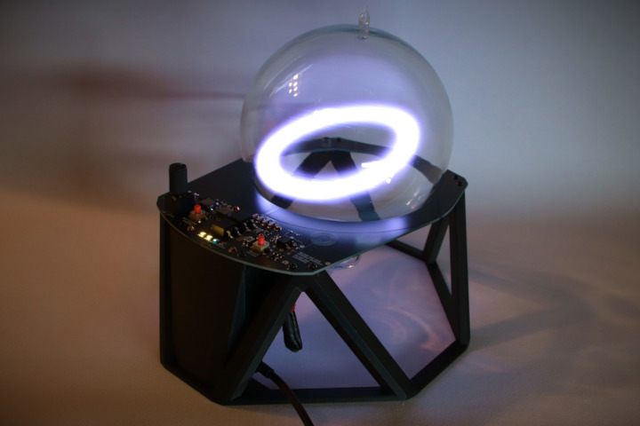

*เครื่องจริงของโปรเจกต์ต้นฉบับ วงแหวนสีขาวอมม่วงคือพลาสมาซีนอนที่ลอยอยู่เหนือคอยล์บนแผ่น PCB ภาพจาก [sky guided](https://codeberg.org/sky-guided/sky-guided-plasma-toroid) (CC-BY-SA)*

---

## การทดลองนี้คืออะไร

ในลูกแก้วมีแก๊สซีนอนความดันต่ำ 15 torr ใต้ลูกแก้วมีคอยล์ทองแดงที่พิมพ์ลงบนแผ่น PCB วงจรบนบอร์ดจ่ายไฟสลับความถี่ประมาณ 10 MHz เข้าคอยล์ สนามแม่เหล็กที่เปลี่ยนไปมาเร็วมากจะเหนี่ยวนำสนามไฟฟ้าวนเป็นวงกลมในแก๊ส (กฎของฟาราเดย์) จนอิเล็กตรอนได้พลังงานพอจะชนอะตอมซีนอนให้แตกตัว แก๊สจึงกลายเป็นพลาสมาที่เรืองแสงเป็นวงแหวน

ถ้าเปรียบเป็นหม้อแปลงไฟฟ้า คอยล์คือขดปฐมภูมิ ส่วนวงแหวนพลาสมาคือขดทุติยภูมิที่มีรอบเดียวและไม่มีสายไฟต่อเลย พลังงานส่งผ่านสนามแม่เหล็กล้วนๆ หลักการนี้เรียกว่า inductively coupled plasma (ICP) และเป็นหลักการเดียวกับโทคาแมคที่ใช้ในงานวิจัยฟิวชัน เพียงแต่ของเราเล็กกว่าและเย็นกว่ามาก

โปรเจกต์นี้ตั้งใจเข้าใจฟิสิกส์ของวงแหวนนี้ให้ลึกถึงระดับสมการ แล้วออกแบบชุดทดลองที่วัดค่าเหล่านั้นได้จริง โดยใช้หนังสือ *Plasma Physics* ของ A. Piel เป็นหลัก

---

## เราทำอะไรไปบ้าง

### 1. ศึกษาทฤษฎีและเขียนเป็นเปเปอร์แบบโต้ตอบได้

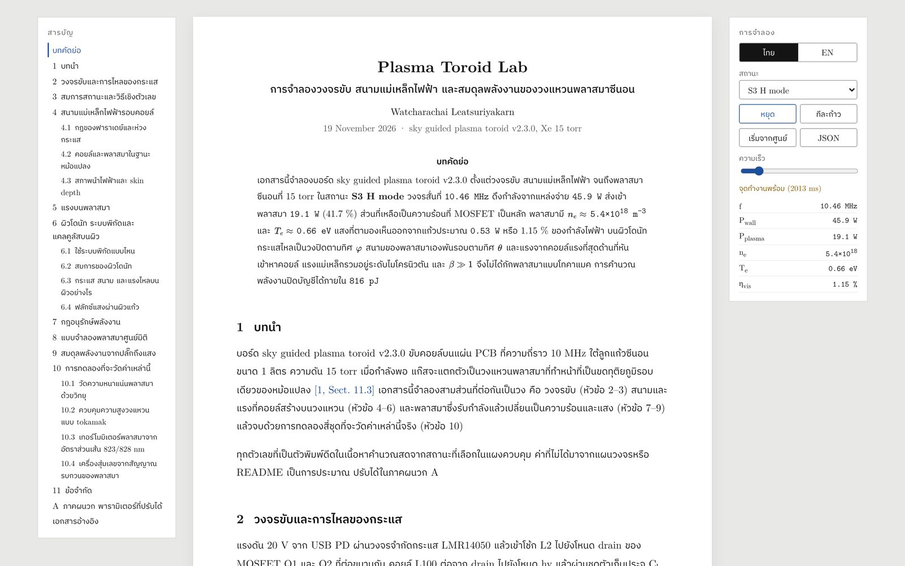

เปเปอร์ในเว็บไซต์เขียนแบบงานวิจัย มีสมการ LaTeX อ้างอิงหน้าหนังสือได้ และตัวเลขทุกตัวคำนวณสดจากแบบจำลอง เลือกสถานะของเครื่องได้ตั้งแต่ S0 (ยังไม่มีพลาสมา) ถึง S3 (โหมด H ที่เป็นวงแหวนสว่าง) และสลับภาษาไทยกับอังกฤษได้

### 2. จำลองวงจรขับและการไหลของกระแส

| แผนวงจรจริงพร้อมกระแสที่ไหล | ธีมมืดแบบ KiCad |
|---|---|
| 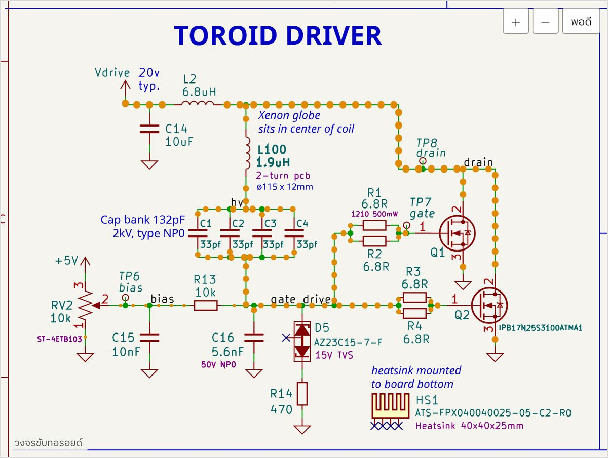 | 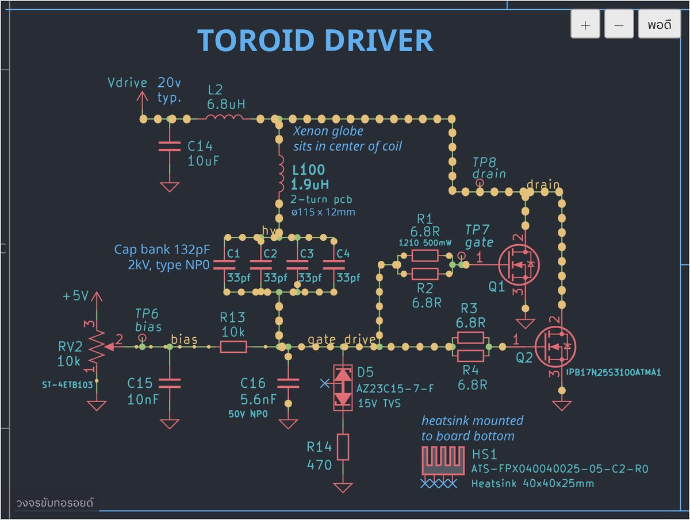 |

ใช้แผนวงจรจริงของบอร์ดจากไฟล์ KiCad แล้วไล่ netlist เพื่อหาว่ากระแสไหลในสายแต่ละช่วงเท่าไร จุดสีส้มวิ่งตามกระแสจริง ในวงจรขับ จุดจะกลับทิศทุกครึ่งรอบของคลื่น 10 MHz เลือกดูทั้งแผ่นหรือทีละบล็อกได้ ปรับ RV1 (จำกัดกระแส) และ RV2 (ไบแอสเกต) แล้วระบบจะคำนวณใหม่ หรือกด SW2 ค้างไว้เพื่อดูวงจรจุดชนวน

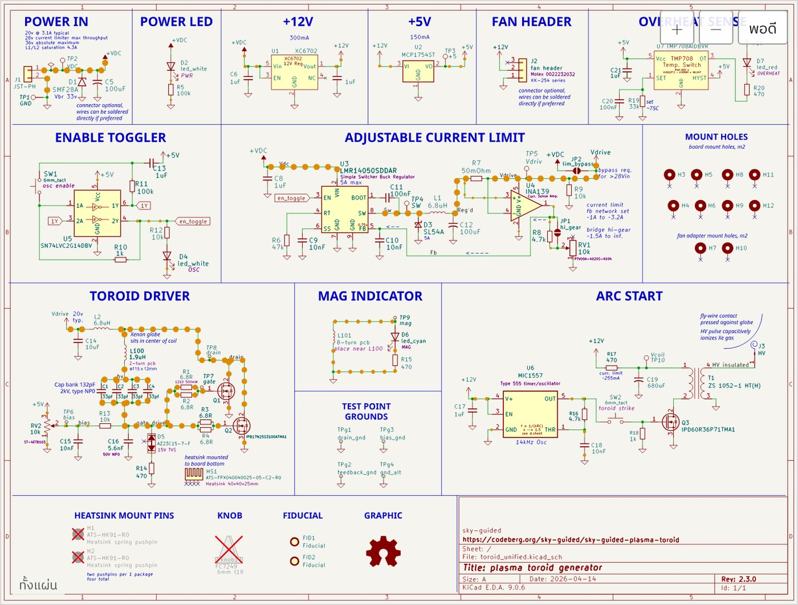

วงจรถูกแก้เป็นสมการเชิงอนุพันธ์ 6 ตัวแปร ด้วยวิธี implicit trapezoid ทุก 0.25 ns รูปด้านล่างคือสัญญาณที่จุดต่างๆ เหมือนดูบนออสซิลโลสโคป

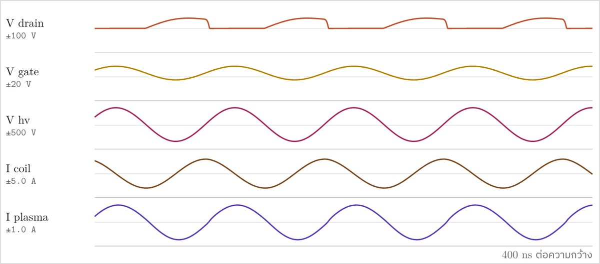

### 3. สนามแม่เหล็กไฟฟ้ารอบคอยล์

| สนามสามมิติ | ภาพตัดขวาง |
|---|---|
| 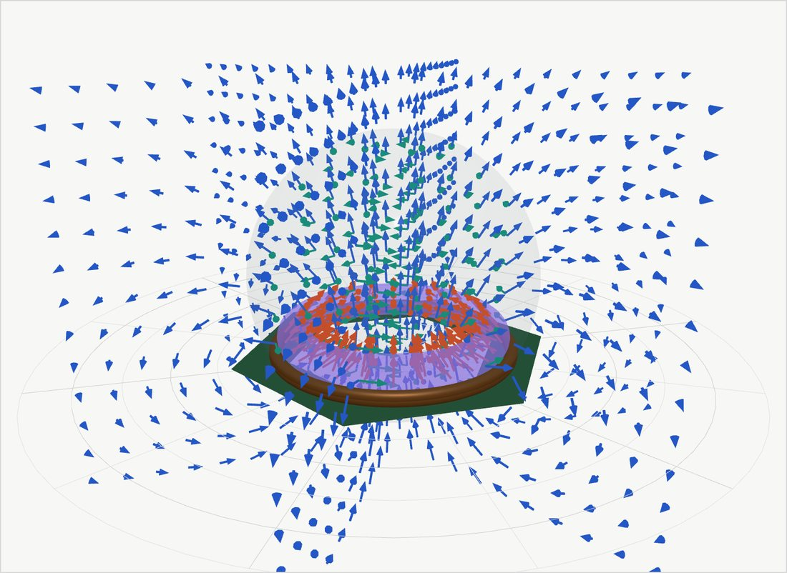 | 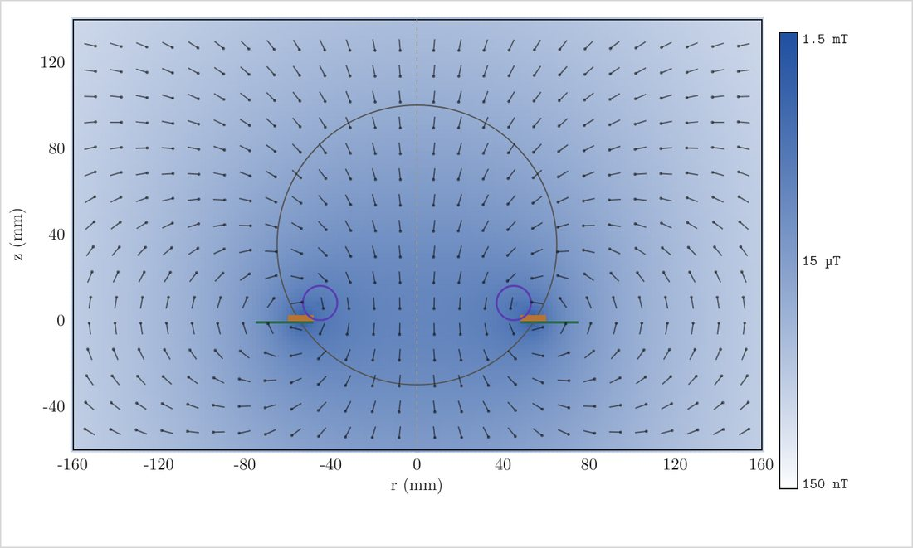 |

คำนวณสนามแม่เหล็ก $\mathbf B$ สนามไฟฟ้าเหนี่ยวนำ $\mathbf E$ และแรงลอเรนซ์ $\mathbf J\times\mathbf B$ บนพลาสมา จากสูตรของห่วงกระแส (elliptic integrals) แล้วตรวจคำตอบด้วยการอินทิเกรตกฎของฟาราเดย์อีกทาง สองวิธีต้องได้ค่าเดียวกัน

สิ่งที่ได้คือแรงแม่เหล็กยกวงแหวนได้เพียงประมาณ 1.5 ไมโครนิวตัน และอัตราส่วน $\beta$ (ความดันพลาสมาต่อความดันแม่เหล็ก) สูงกว่า 100 แปลว่าสนามแม่เหล็กอ่อนเกินกว่าจะกักพลาสมาแบบโทคาแมค ตัวกักจริงคือผนังแก้วกับแก๊สความดันสูง

### 4. แคลคูลัสบนผิวโดนัท

| ผิวโดนัทสามมิติ | ผิวที่คลี่ออกเป็นสี่เหลี่ยม |
|---|---|
| 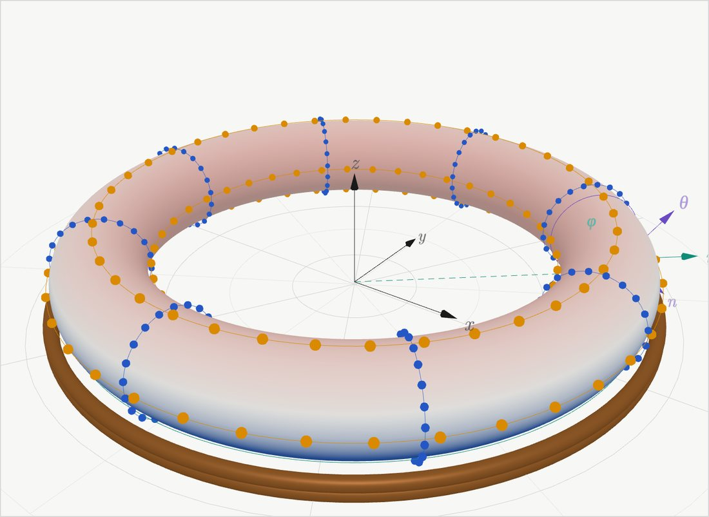 | 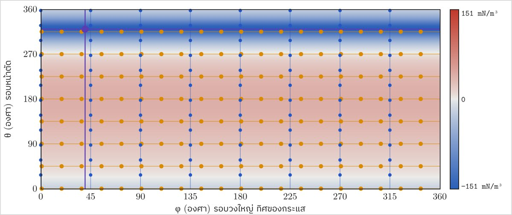 |

ตอบคำถามว่าควรใช้ระบบพิกัดแบบไหน
- **พิกัดเชิงขั้ว (ทรงกระบอก)** ใช้คำนวณสนาม เพราะทุกอย่างสมมาตรรอบแกน ปัญหาสามมิติจึงเหลือสองมิติ
- **พิกัดฉาก** ใช้วาดภาพสามมิติ
- **มุม $\theta$ และ $\varphi$ ของทอรัส** ใช้บนผิวโดนัท

กระแสไหลรอบวงใหญ่ตามทิศ $\varphi$ เป็นวงปิดที่ไม่มีจุดเริ่มต้น และกลับทิศทุกครึ่งรอบ สนามของพลาสมาเองพันรอบหน้าตัดตามทิศ $\theta$ แรงจากคอยล์แรงที่สุดด้านที่หันเข้าหาคอยล์ ประมาณ $\theta \approx 322^\circ$

| แรงบนผิวเทียบกับมุม $\theta$ | แสงที่ตกบนผิวแก้ว |
|---|---|
| 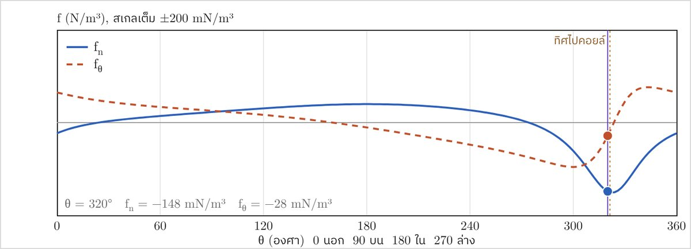 | 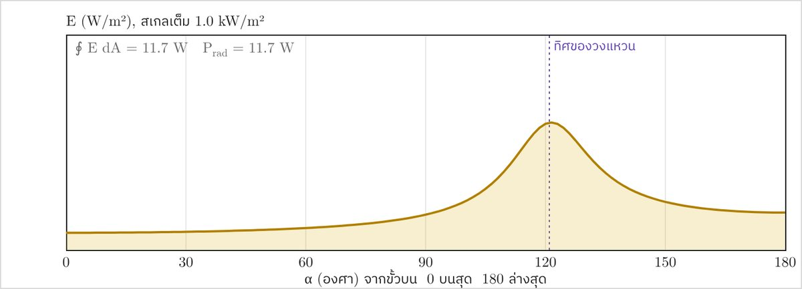 |

ใช้ทฤษฎีบทไดเวอร์เจนซ์ตรวจว่าแสงรวมที่ผ่านผิวแก้วเท่ากับกำลังที่พลาสมาแผ่ออกมา แสงแรงที่สุดอยู่ในแถบที่หันเข้าหาวงแหวน ซึ่งบอกว่าควรติด photodiode ตรงไหน

### 5. แบบจำลองพลาสมาและสมดุลพลังงาน

| อัตราการชนจาก Maxwell distribution | ตรวจกฎอนุรักษ์พลังงาน |
|---|---|
| 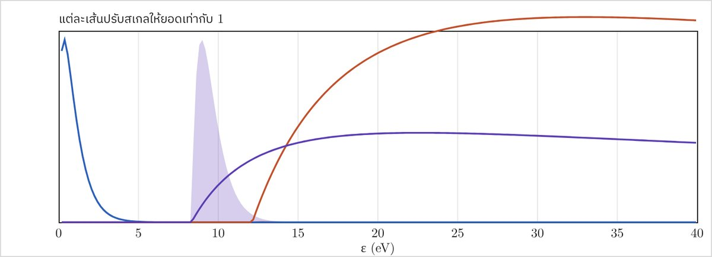 | 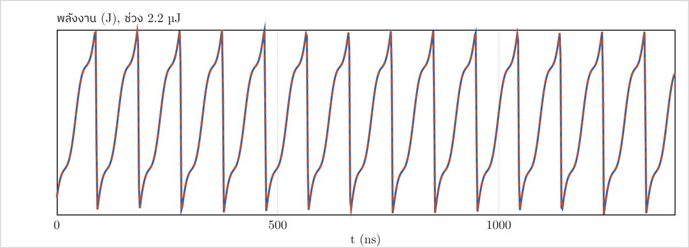 |

แบบจำลองพลาสมาศูนย์มิติของซีนอนหาอุณหภูมิอิเล็กตรอน $T_e$ จากสมดุลอนุภาค และหาความหนาแน่น $n_e$ จากสมดุลกำลัง ส่วนบัญชีพลังงานของวงจรปิดได้ภายในระดับนาโนจูลจากพลังงานเข้าราว 1.3 มิลลิจูล

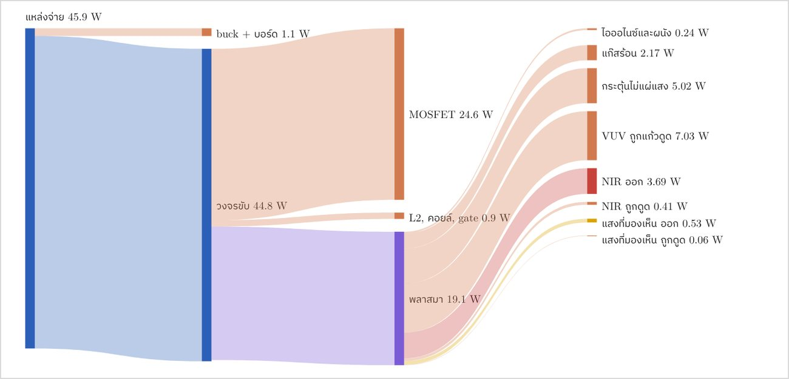

ผังนี้ตอบว่าไฟฟ้าที่เสียบเข้าไปหายไปไหนบ้าง ส่วนใหญ่กลายเป็นความร้อนที่ MOSFET กับในพลาสมา เหลือเป็นแสงที่ตามองเห็นได้เพียงประมาณ 1 เปอร์เซ็นต์

### 6. ออกแบบชุดทดลอง

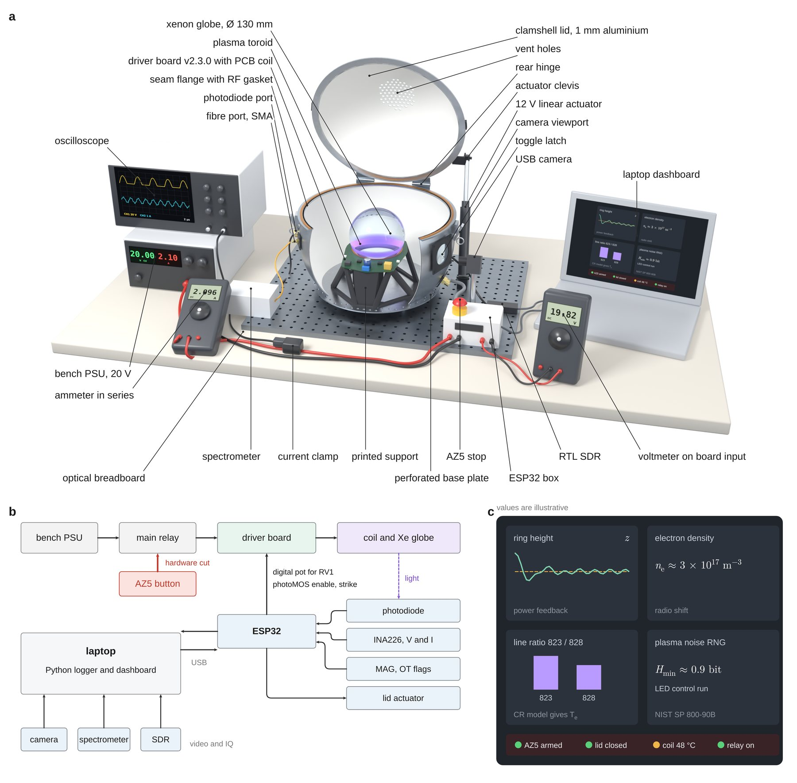

แนวคิดการจัดชุดทดลองบนโต๊ะ
- **(a)** ตำแหน่งเครื่องมือวัด ได้แก่ bench PSU มัลติมิเตอร์ ออสซิลโลสโคป สเปกโตรมิเตอร์ กล้อง และ RTL SDR
- **(b)** ระบบควบคุมด้วย ESP32 พร้อมปุ่มตัดไฟฉุกเฉิน AZ5 ที่ตัดรีเลย์โดยไม่ผ่านซอฟต์แวร์
- **(c)** ตัวอย่างหน้า dashboard ค่าบนจอเป็นค่าสมมติ

โดมในรูปนี้เป็นแบบรุ่นแรก ซึ่งต่อมาเปลี่ยนเป็นกาละมังอะลูมิเนียมสองใบตามหัวข้อถัดไป

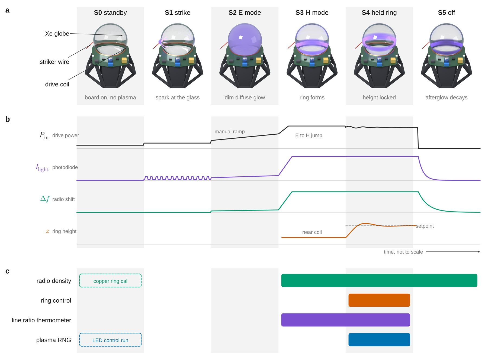

หนึ่งรอบการทดลองมี 6 ขั้น ตั้งแต่ S0 standby, S1 จุดชนวน, S2 โหมด E แสงจาง, S3 โหมด H เป็นวงแหวน, S4 ตรึงความสูงวงแหวน จนถึง S5 ปิดเครื่อง แถบด้านล่างบอกว่าการทดลองแต่ละชุดเก็บข้อมูลในขั้นไหน สัญญาณในรูปเป็นภาพเชิงคุณภาพ ยังไม่ได้วัดจริง

### 7. ตู้กันสนามจากกาละมังอะลูมิเนียม

| ฝาเปิด | ด้านใน |
|---|---|
| 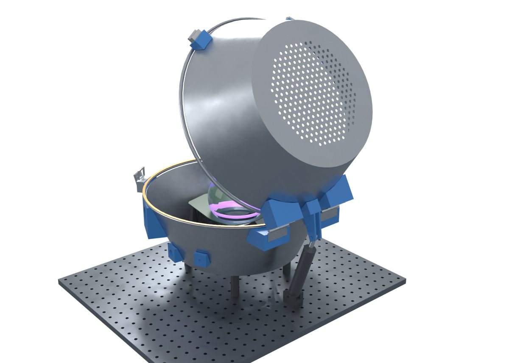 | 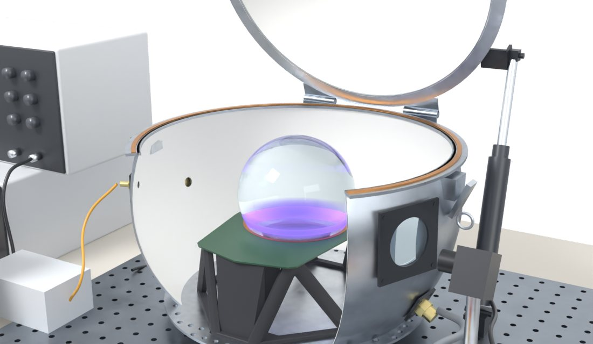 |

ออกแบบด้วย CAD (build123d) ให้ประกอบได้จริง บานพับ ล็อก และพอร์ตต่างๆ ยึดผ่านแท่นพิมพ์ 3D ที่แนบพอดีกับผิวโค้งของกาละมัง ไม่ยึดตรงกับผิวโค้ง

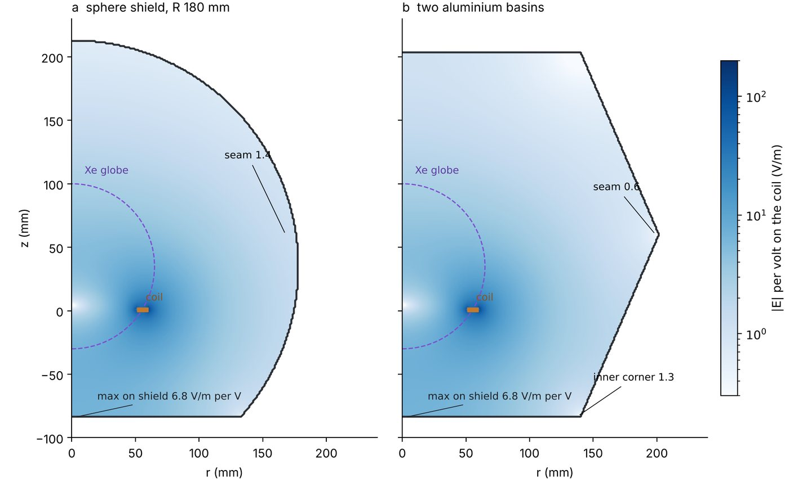

ก่อนเลือกกาละมัง ได้จำลองสนามไฟฟ้าเทียบกับโดมทรงกลม เพื่อตอบคำถามว่ามุมและรอยต่อของกาละมังจะทำให้ประจุไปรวมจุดหรือไม่ ผลคือสนามสูงสุดบนผนังเท่ากันที่ 6.8 V/m ต่อโวลต์บนคอยล์ เพราะจุดที่สนามแรงที่สุดอยู่ใกล้คอยล์ ไม่ใช่ที่มุม

---

## ตัวเลขสำคัญจากแบบจำลอง (โหมด H, 15 torr)

| ปริมาณ | ค่า |
|---|---|
| ความถี่วงจร | 10.46 MHz |
| กำลังจากแหล่งจ่าย | 45.9 W |
| กำลังที่เข้าพลาสมา | 19.1 W (41.7 %) |
| ความร้อนที่ MOSFET | 24.6 W |
| ความหนาแน่นอิเล็กตรอน $n_e$ | $5.4\times10^{18}\ \text{m}^{-3}$ |
| อุณหภูมิอิเล็กตรอน $T_e$ | 0.66 eV |
| แสงที่ตามองเห็นออกจากแก้ว | 0.53 W (1.15 %), ประมาณ 43 lm |
| แรงยกจากสนามแม่เหล็ก | ประมาณ 1.5 µN |
| ความถี่ที่เลื่อนเมื่อเกิดพลาสมา $\Delta f$ | ประมาณ +164 kHz |

ทุกค่าเป็นผลจากแบบจำลอง ยังไม่ใช่ค่าที่วัดจริง ค่าที่ไม่มีในแผนวงจร เช่น $C_{oss}$ ขณะทำงานและสัดส่วนสเปกตรัม เป็นการประมาณ ซึ่งปรับได้ในภาคผนวกของเปเปอร์ รายละเอียดข้อจำกัดอยู่ในหัวข้อ 11 ของเปเปอร์

## การทดลองสี่ชุดที่วางแผนไว้

1. **วัดความหนาแน่นพลาสมาด้วยวิทยุ** ใช้ RTL SDR จับความถี่ของวงจรที่เลื่อนขึ้นเมื่อเกิดพลาสมา แล้วย้อนหา $n_e$
2. **ควบคุมความสูงวงแหวนแบบโทคาแมค** ใช้กล้องวัดความสูง แล้วปรับกำลังขับด้วย feedback
3. **เทอร์โมมิเตอร์พลาสมา** ใช้อัตราส่วนความเข้มของเส้นสเปกตรัมซีนอน 823 และ 828 nm หาอุณหภูมิอิเล็กตรอน
4. **เครื่องสุ่มเลขจากพลาสมา** ใช้สัญญาณรบกวนของแสงพลาสมาสร้างเลขสุ่ม และประเมินตามมาตรฐาน NIST SP 800-90B

---

## ไฟล์ / Files

| File | Purpose |
|---|---|
| `index.html` | The paper, layout and equations (MathJax) |
| `app.js` | Figures, live circuit animation, 3D views (three.js), language switch |
| `physics.js` | Circuit solver, coil fields, 0D xenon plasma model, torus surface calculus |
| `worker.js` | Runs the operating point off the main thread |
| `schem.js` | KiCad sheet viewer with live current flow |
| `sheet.js`, `sheet_dark.js` | The board schematic, compacted from the original KiCad export |
| `fonts.css` | Latin Modern and IBM Plex Sans Thai, embedded |
| `docs/images/` | Pictures used in this README |

ทุกไฟล์เป็น static เปิด `index.html` ในเครื่องได้เลย หรือวางบนโฮสต์แบบ static ใดก็ได้

## English summary

An interactive paper by **Watcharachai Leatsuriyakarn** on the sky guided plasma toroid v2.3.0. A printed coil driven at about 10 MHz induces a circular electric field in 15 torr xenon, which breaks down into a glowing plasma ring that acts as the one-turn secondary of a transformer. The work covers:

- **Drive circuit:** a live simulation on the board's own KiCad schematic, with current flow drawn on every wire.
- **Fields and forces:** 3D electromagnetic fields and the Lorentz force on the ring.
- **Surface calculus:** coordinates and integrals on the torus surface, plus the light flux through the glass.
- **Plasma model:** a 0D xenon model and a plug-to-light energy balance.
- **Bench design:** a lab setup with an aluminium basin shield enclosure.
- **Planned experiments:** radio density, ring height control, the 823/828 nm thermometer and a plasma noise RNG.

All figures above are model outputs or renders, not measurements.

## สัญญาอนุญาตและเครดิต / Licence and credits

ใช้สัญญาอนุญาตเดียวกับโปรเจกต์ต้นฉบับ คือ **CC BY-SA 4.0** (Creative Commons Attribution-ShareAlike) นำไปใช้และดัดแปลงได้ รวมถึงเชิงพาณิชย์ โดยต้องให้เครดิตทั้งสองฝ่ายด้านล่าง และเผยแพร่งานดัดแปลงด้วยสัญญาอนุญาตเดียวกัน รายละเอียดอยู่ในไฟล์ [LICENSE](LICENSE)

This repository uses the same licence as the original project, **CC BY-SA 4.0**. You may share and adapt it, commercially too, as long as you credit both parties below and release your changes under the same licence.

| ส่วน / Part | ผู้สร้าง / Author |
|---|---|
| ฮาร์ดแวร์ แผนวงจร และภาพถ่ายเครื่องจริง / Original hardware, schematic and device photo | sky guided, [sky-guided-plasma-toroid](https://codeberg.org/sky-guided/sky-guided-plasma-toroid) (CC-BY-SA) |
| การจำลอง เปเปอร์ รูป เรนเดอร์ และโค้ด / Simulation, paper, figures, renders and code | Watcharachai Leatsuriyakarn |

ต้นฉบับระบุสัญญาอนุญาตเป็น CC-BY-SA โดยไม่ได้ระบุเวอร์ชัน รีโพนี้จึงใช้เวอร์ชันล่าสุดคือ 4.0
The original states CC-BY-SA without a version number, so this repository uses the current version, 4.0.

ฟอนต์และไลบรารีภายนอกใช้สัญญาอนุญาตของตัวเอง ได้แก่ Latin Modern (GUST Font License), IBM Plex Sans Thai (SIL OFL 1.1), three.js (MIT) และ MathJax (Apache-2.0)

อ้างอิงทางฟิสิกส์อยู่ท้ายเปเปอร์ หลักๆ คือ A. Piel, *Plasma Physics*, 2nd ed., Springer, 2017

Powered by Claude Opus 5.5
